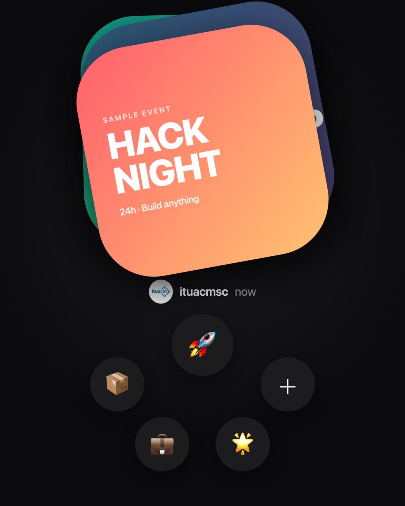
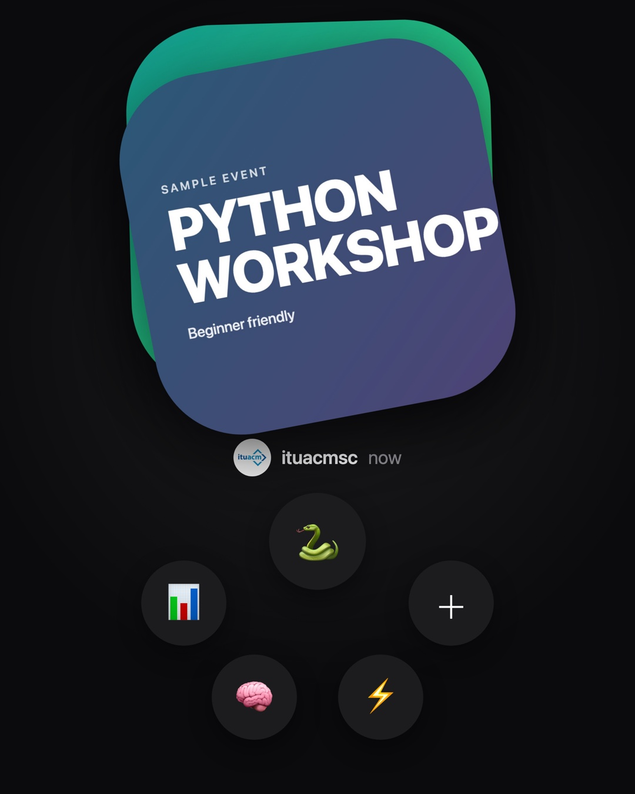
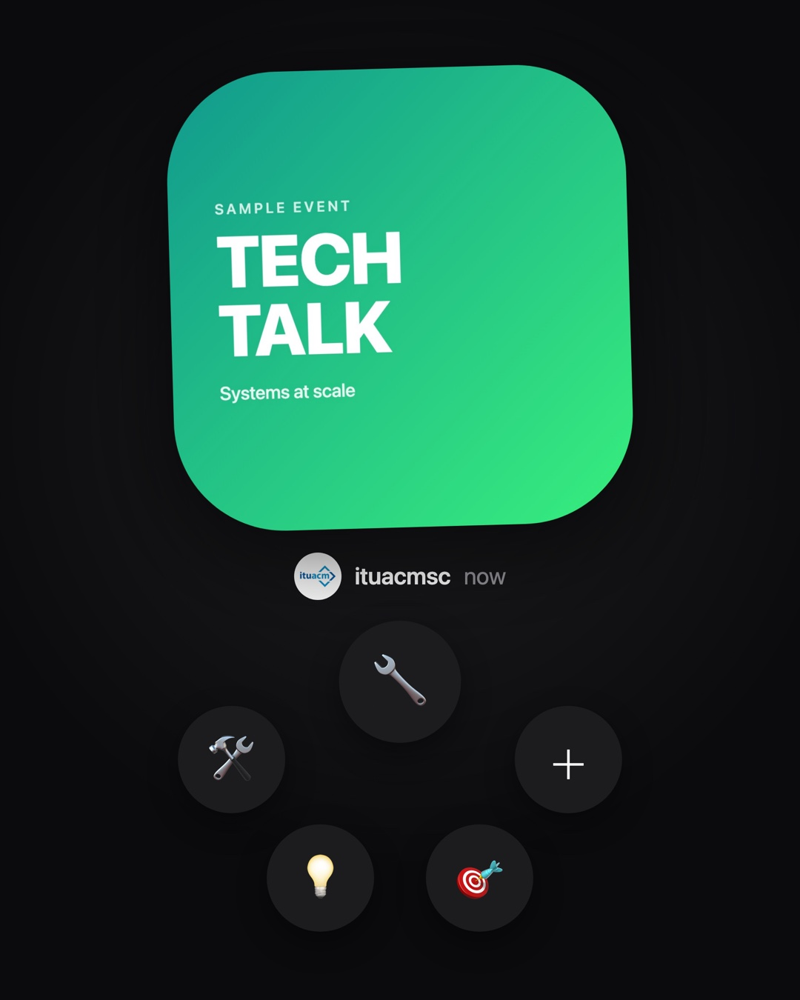
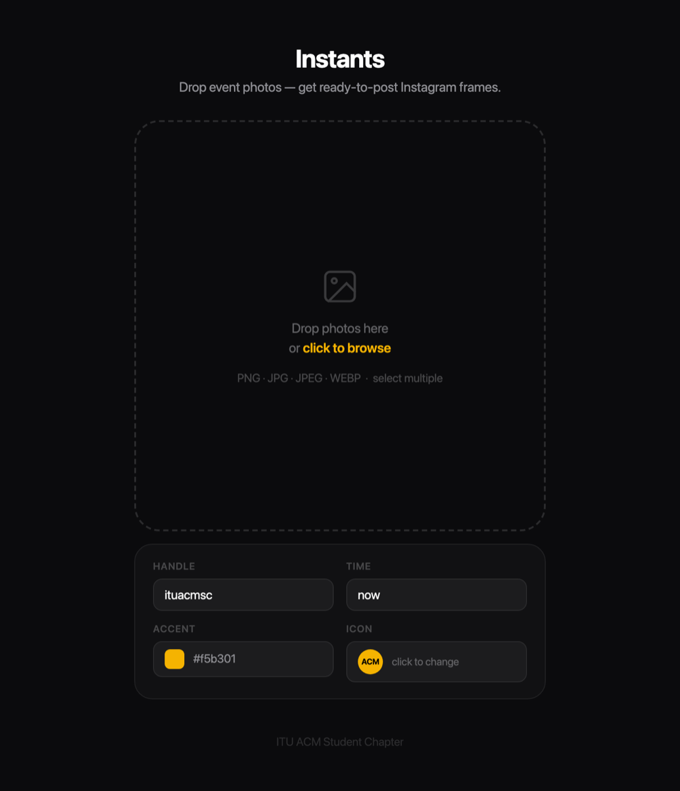
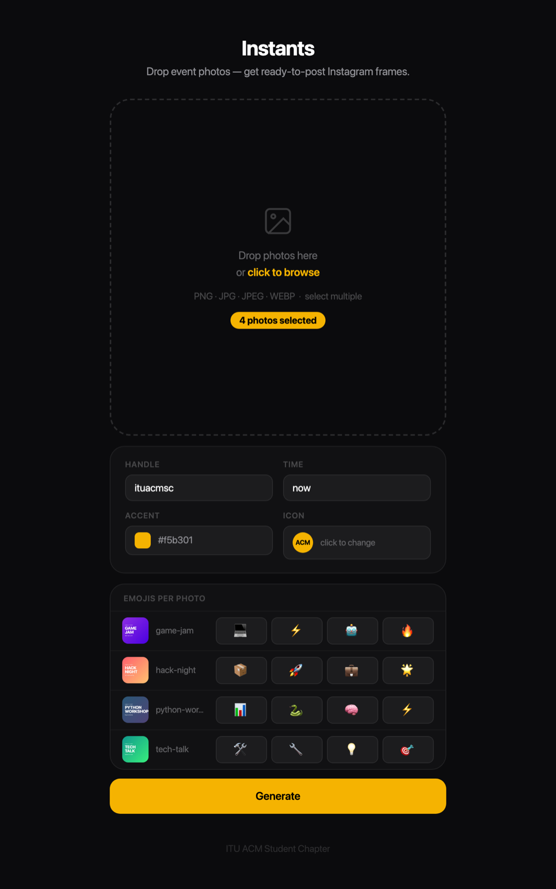
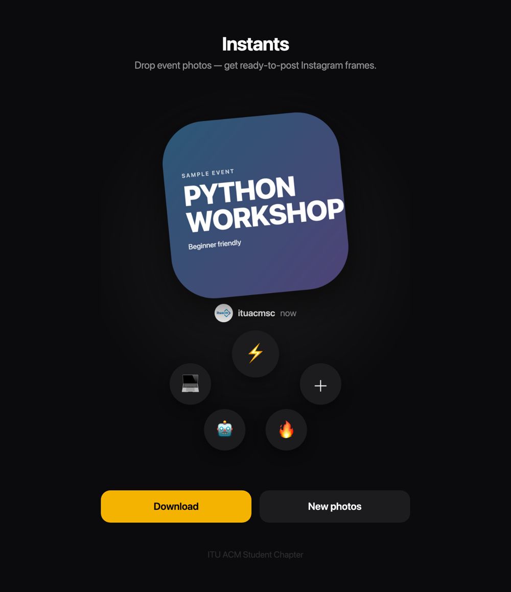

# Instants

Turn event posters and photos into ready-to-post Instagram frames for the ITU ACM Student Chapter.

Each frame is a 4:5 (1080×1350) post. The current image sits on a rounded card with the next two images peeking out behind it. Below the card are the chapter handle and a row of emoji "reaction" bubbles. Post a batch in order and it reads like a stack you're flipping through.

<p align="center">
  
  
  
</p>

There are two ways to use it:

- **Web app** (`server.py`): upload photos in the browser and download a PNG, or a ZIP for several photos.
- **CLI** (`main.py`): drop images into `events/` and render them all into `outputs/`, with an optional watch mode.

Both render [`template.html`](template.html) in headless Chromium through Playwright, so a post looks the same whichever way you make it.

## Web app

<p align="center">
  
  
  
</p>

```bash
uvicorn server:app --reload
```

Open http://127.0.0.1:8000, drop one or more photos, and click **Generate**.

- **Handle / Time:** the attribution text under the card (defaults: `ituacmsc`, `now`).
- **Accent:** the color of the fallback icon circle.
- **Icon:** upload a custom avatar. If you skip it, `assets/icon.jpg` is used.
- **Emojis per photo:** four emojis for each uploaded image, pre-filled from the built-in sets.

One photo comes back as a PNG preview with a download button. Several photos come back as `instants.zip`, stacked in upload order. Card rotations are randomized per request and aren't saved.

### API

`POST /generate` takes `multipart/form-data`:

| Field         | Type          | Notes                                                       |
| ------------- | ------------- | ----------------------------------------------------------- |
| `files`       | image, repeat | Required. One or more images, rendered in the order sent.   |
| `handle`      | string        | Optional. Defaults to `CONFIG["handle"]`.                   |
| `time`        | string        | Optional. Defaults to `CONFIG["time"]`.                     |
| `accent`      | string        | Optional hex color. Defaults to `CONFIG["accent"]`.         |
| `emojis_json` | JSON string   | Optional. `[["💻","⚡","🤖","🔥"], ...]`, one row per image. |
| `icon`        | image         | Optional avatar. Falls back to `assets/icon.jpg`.           |

It returns `image/png` for a single file and `application/zip` for several.

```bash
curl -F files=@poster.jpg -F handle=ituacmsc -o poster-instant.png http://127.0.0.1:8000/generate
```

## CLI

```bash
python main.py                  # render every image in ./events
python main.py poster.png       # render a single file from ./events
python main.py --watch          # re-render whenever ./events changes
```

Supported formats are `.png`, `.jpg`, `.jpeg` and `.webp`. Results are written to `outputs/<name>-instant.png` at 2× scale (2160×2700).

### Configuration

Global defaults live in `CONFIG` at the top of [`main.py`](main.py): handle, time text, accent color, icon path and folders. `EMOJI_SETS` is cycled through, one set per image.

For per-event overrides, copy [`events.example.json`](events.example.json) to `events.json`. Keys are image filenames without the extension:

```json
{
  "amazon-visit":  { "emojis": ["📦","🚀","💼","🔥"] },
  "data-workshop": { "emojis": ["📊","🐍","🤖","⚡"], "time": "tomorrow" }
}
```

| Key                    | Effect                                                                  |
| ---------------------- | ----------------------------------------------------------------------- |
| `emojis`               | Four emojis: `[left, top, bottom-left, bottom-right]`.                  |
| `handle`, `time`, `accent` | Override the global value for this image.                           |
| `order`                | Sort position in the batch. Unlisted images follow, sorted by filename. |
| `rotation`, `tx`, `ty` | Card tilt and back-card offset. Generated and saved automatically.      |

On the first render, the CLI writes a random `rotation`/`tx`/`ty` for each image into `events.json`. Re-runs keep the same layout, so a carousel posted in batches stays consistent. Delete those keys to reroll an image.

## Setup

You need Python 3.10 or newer.

```bash
python -m venv .venv
source .venv/bin/activate
pip install -r requirements.txt
playwright install chromium
```

The template uses the system font stack (SF Pro on macOS) and the platform's color emoji font. On Linux, install `fonts-noto-color-emoji` or the emoji bubbles will render as boxes.

## Docker

The [`Dockerfile`](Dockerfile) bundles Chromium and Noto Color Emoji, and serves the web app on port 8080:

```bash
docker build -t instants .
docker run -p 8080:8080 instants
```

## Project layout

```
main.py              CLI + shared config (CONFIG, EMOJI_SETS)
server.py            FastAPI web app and /generate endpoint
template.html        The 1080×1350 frame that gets screenshotted
static/index.html    Web UI
assets/icon.jpg      Default avatar
events.example.json  Sample per-event overrides
```

`events/`, `outputs/`, `events.json` and `tmp/` are gitignored, so event photos and renders stay local.

The screenshots in this README were made with synthetic sample posters.
